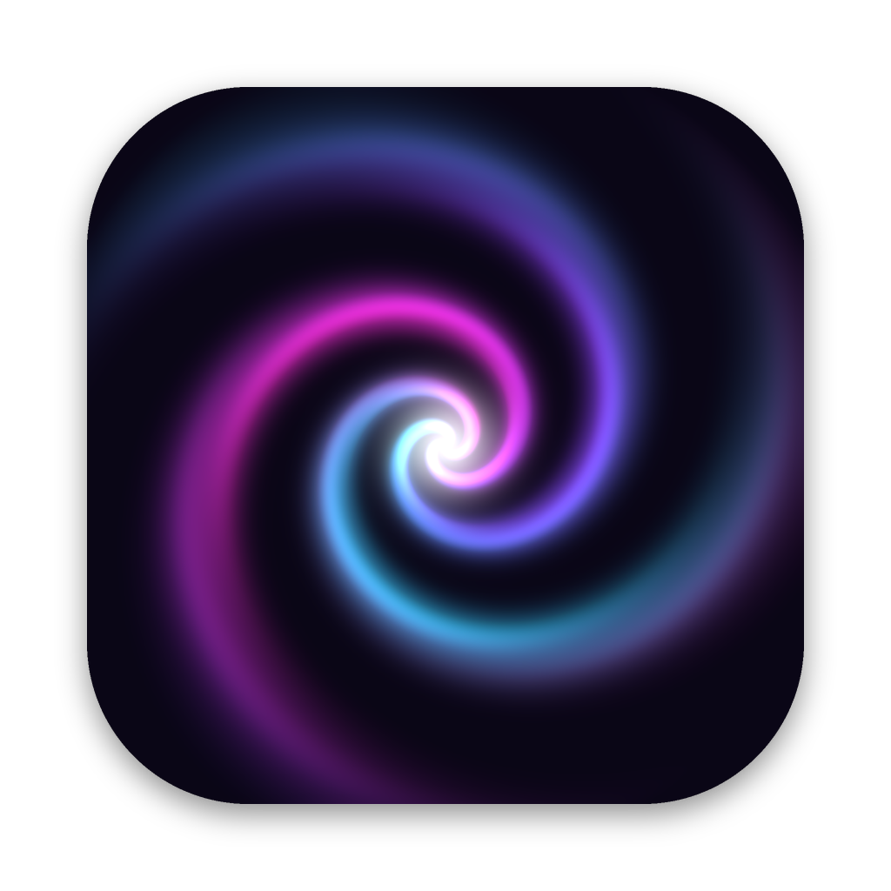

# LittingtonVizualizer



A desktop app (macOS, with an untested Windows build) that fills the screen with live, audio-reactive Winamp / Milkdrop-style visuals driven by whatever is playing in **YouTube Music** or **Spotify**, with the album art, title, artist, lyrics and up-next queue floating on top.

## Use it

Play something in YouTube Music or Spotify, then open **LittingtonVizualizer** from Applications. It finds the app that is playing, starts listening to it, and shows the track, artwork and lyrics on its own. Nothing else to start first.

The first launch asks once whether it may capture audio. Allow it.

## Windows

> The Windows version was written and packaged on a Mac and **has not been run on Windows yet**. Treat it as a first build to try, not a finished release.

1. Download `LittingtonVizualizer-Setup-0.1.0.exe` and run it. Windows SmartScreen will warn that the publisher is unknown, because the installer isn't code-signed: choose **More info → Run anyway**. It installs for your user account only and opens when done.
2. Play something in the **Spotify desktop app**, or in **YouTube Music installed as an app** (in Chrome on music.youtube.com: ⋮ → Cast, save and share → Install page as app). A YouTube Music browser tab doesn't count.
3. Open LittingtonVizualizer.

How Windows differs from the Mac version:

| | macOS | Windows |
|---|---|---|
| Sound the visuals react to | Only the music app | Everything the PC is playing |
| Track info | Now Playing / AppleScript | Windows media controls (the same info as the volume flyout) |
| Artwork | From the source, or looked up | Always looked up by song name |
| Up-next queue | Extension (YouTube Music), login (Spotify) | Same |

Build the installer yourself with `npm run dist:win` (works from a Mac), or run the **Windows installer** workflow in the repository's Actions tab, which builds it on a real Windows machine and attaches the `.exe` to the run.

## Install or update (macOS)

Requirements: macOS 14.2 or later, Node 22+, Xcode command line tools (for Swift).

```bash
npm install
```

```bash
npm run install-app
```

`install-app` builds the audio helper, packages the app, and replaces the copy in `/Applications`. It signs with the Apple Development certificate in your keychain, so the audio permission survives updates.

To run from source instead (macOS asks for the audio permission again whenever the helper is rebuilt):

```bash
npm run build:native
```

```bash
npm start
```

## What it does

**On launch**
- Detects whether the YouTube Music app (the Chrome-installed web app) or the Spotify desktop app is running. Browser tabs don't count.
- Picks the active source automatically. If both are running, YouTube Music wins unless Spotify is the only one actually playing.
- Starts rendering as soon as audio is flowing. With nothing playing, the visuals breathe gently instead of freezing.

**Visuals**
- 20 animated presets (list below): fluid feedback, fractals, tunnels, reactive meshes and particle fields.
- Driven by the real audio: bass, mid and treble levels, beat pulses, and the live spectrum and waveform.
- Palette tinted from the current track's album art (press `C` for rainbow instead).
- A new preset blends in on every track change and every 30 seconds. Arrow keys skip; `L` locks the current one.

**Layout**

```
┌──────────────────────────────────────────────────────────┐
│ ░░░░░░░░░░░ full-bleed live visualization ░░░░░░░░░░░░░░ │
│ ░░ ┌───────────┐                                      ░░ │
│ ░░ │           │   SONG TITLE (bold, large)           ░░ │
│ ░░ │ album art │   Artist — Album                     ░░ │
│ ░░ │           │   [Lyrics] [Up next]                 ░░ │
│ ░░ │           │   synced lyrics  /  up-next queue    ░░ │
│ ░░ └───────────┘                                      ░░ │
│ ░░░░░░░░░░░░░░░░░░░░░░░░░░░░░░░░░░░░░░░░░░░░░░░░░░░░░░░░ │
└──────────────────────────────────────────────────────────┘
```

A normal resizable window that goes fullscreen with `F`. Art and text scale with the window; tall narrow windows stack the art above the text.

**Mood**

The app looks up each song's genre and matches the visuals to it:

| Mood | Genres | What changes |
|---|---|---|
| Hype | Hip-hop, rap, trap, drill, metal, punk | Fast motion, hard cuts every ~14 s, the picture lunges and flashes on every beat, angular presets (tunnels, fractals, meshes) |
| Smooth | R&B, soul, jazz, blues, ambient, lo-fi | Slow motion, 5-second dissolves every ~45 s, beats only nudge, fluid presets (ink, smoke, aurora, liquid) |
| Pop | Pop, dance, electronic, Latin, funk | Bright and saturated, bouncy, colourful presets |
| Neutral | Anything else, or genre unknown | All 20 presets, the original pacing |

Press `V` or use the gear menu to pin a mood instead of following the genre. Genres come from the iTunes catalogue, so they follow how a song is filed there; `ARTIST_MOODS` in `src/main/art/lookup.js` overrides the mood for specific artists (Drake is set to Smooth).

**How much song info to show**

The gear button in the top-right corner (it fades in when the pointer moves and is solid when hovered) or the `M` key switches between:

| Mode | What you see |
|---|---|
| Full | The big album art, title, and lyrics / up-next panel |
| Corner | Just the visuals, with a small cover, title and artist tucked into a corner you pick |
| Off | Visuals only |

The choice is remembered between launches.

## Hotkeys

| Key | Action |
|---|---|
| `F` | Toggle fullscreen |
| `←` / `→` | Previous / next preset |
| `L` | Lock or unlock the current preset |
| `Tab` | Switch the lower panel between lyrics and up next |
| `M` | Song info: full → corner → off |
| `V` | Mood: auto → hype → smooth → pop → neutral |
| `C` | Album-art colours or rainbow |
| `H` | Hide or show everything on top of the visuals |
| `?` | Show the key hints |

## One-time setup per source

### YouTube Music

Visuals, track info, artwork and lyrics work with no setup: the app reads the track from macOS's Now Playing info.

Only the **up-next queue** needs the companion extension, because the Chrome-installed app shares its queue with nobody:

1. In the app, open **Up next** (`Tab`) and press **Set up extension**. Chrome opens its Extensions page and Finder highlights a folder named `extension`.
2. On the Extensions page, switch on **Developer mode** (top right).
3. Drag the highlighted `extension` folder from Finder onto that page.

Already-open YouTube Music windows start reporting immediately. The queue appears once YouTube Music's player page has been opened, since that is when the page loads it. With the extension installed, artwork also comes straight from YouTube Music instead of a lookup.

Because the Chrome-installed app plays its sound through Chrome itself, the visuals react to **all audio from Chrome**, including other tabs. Sound from other apps is ignored.

### Spotify

Track info, album art and lyrics work with no login; macOS asks once whether the app may control Spotify.

The queue needs a one-time login, because the desktop app doesn't expose it locally:

1. Create a free app at [developer.spotify.com/dashboard](https://developer.spotify.com/dashboard).
2. Add the redirect URI `http://127.0.0.1:38217/spotify-callback`.
3. In LittingtonVizualizer, press `Tab` to open **Up next**, paste the app's Client ID and press **Connect Spotify**.

Spotify may limit the queue to Premium accounts.

## How it works

| Piece | Approach |
|---|---|
| **Audio** | `native/audio-tap` is a small Swift helper using a Core Audio process tap. It captures only the processes belonging to the music app, mixes them to mono, and pipes float32 PCM to Electron. It never changes what you hear. It carries its own permission description, so macOS prompts for it once however the app was started. |
| **Analysis** | `audio-analyser.js` runs a 2048-point FFT each frame: auto-levelled bass / mid / treble, bass-onset beat detection, and a 512-column spectrum + waveform texture. |
| **Visuals** | `engine.js` is a WebGL2 feedback renderer. Each preset is one fragment shader that receives the previous frame, the audio values and the album palette. Preset changes cross-fade two shaders over the same feedback buffer. Rendering is capped at 1080 lines and upscaled. |
| **Now Playing** | `sources/now-playing.js` asks macOS what is playing (title, artist, album, playhead, owning app) through `osascript`, with no permission prompt. It is the zero-setup source for YouTube Music and the fallback for Spotify. |
| **Spotify** | AppleScript for now-playing; Web API with PKCE for the queue. The refresh token is stored encrypted via the macOS keychain. |
| **YouTube Music queue** | The extension's content script reads the page once a second; its service worker posts to `http://127.0.0.1:38217/ytm`, a server that listens on this computer only and accepts only extension origins. |
| **Lyrics** | [LRCLIB](https://lrclib.net): synced lyrics when available, plain otherwise. Track title, artist, album and length are sent to LRCLIB to look them up. |
| **Mood** | `art/lookup.js` gets the genre from the iTunes Search API and maps it to a mood; `viz/moods.js` defines what each mood does. The engine scales its clock, audio gains, beat kick, saturation and contrast by the mood, and the scheduler takes its preset pool, interval and fade from it. |
| **Windows** | `platform/windows.js` keeps one PowerShell process reading the system media sessions; `viz/loopback.js` captures system audio in the window. `platform/mac.js` wraps the Mac-only pieces behind the same interface. |
| **Album art** | From Spotify or the extension when they supply it; otherwise looked up by artist and title on the iTunes Search API. Downloaded by the main process, handed to the window as data, and reduced to three vivid colours for the shaders. |

## Presets

| # | Name | # | Name |
|---|---|---|---|
| 01 | liquid feedback | 11 | vortex starfield |
| 02 | plasma bloom | 12 | moire pulse |
| 03 | warp tunnel | 13 | lava cells |
| 04 | kaleido fractal | 14 | crystal lattice |
| 05 | julia drift | 15 | spiral galaxy |
| 06 | mandel zoom | 16 | waveform halo |
| 07 | reactive mesh | 17 | fractal flame |
| 08 | particle nebula | 18 | hex tunnel |
| 09 | ink in water | 19 | smoke tendrils |
| 10 | aurora ribbons | 20 | chromatic rings |

### Writing a preset

Add a `NN-name.frag` file to `src/renderer/viz/presets/`; it is picked up on the next launch. Define one function:

```glsl
vec3 render(vec2 uv, vec2 p) { ... }   // uv: 0..1    p: centred, aspect-correct
```

Available to every preset (see the header in `engine.js`):

| Name | Meaning |
|---|---|
| `uBass`, `uMid`, `uTreb`, `uVol` | Smoothed levels, about 0.5 on average, up to ~1.5 |
| `uBeat`, `uBeatN` | 1 on a beat fading to 0; running beat count |
| `uTime`, `uFlow`, `uSeed` | Seconds; a clock that speeds up with volume; a random number per activation |
| `prev(uv)`, `toUv(p)` | The previous frame, for feedback; convert `p` back to `uv` |
| `spec(x)`, `wave(x)` | Spectrum (bass at 0) and waveform, `x` in 0..1 |
| `pal(t)` | The colour ramp: album-art colours, or rainbow |
| `noise`, `fbm`, `rot`, `hash21`, `hash22` | Helpers |

## Project structure

```
.
├── package.json              scripts and dependencies
├── electron-builder.yml      packaging config
├── src/
│   ├── main/                 Electron main process
│   │   ├── main.js           window, source loop, requests from the window
│   │   ├── preload.js        the only bridge to the window
│   │   ├── settings.js       saved settings and encrypted secrets
│   │   ├── sources/          detect.js, now-playing.js, spotify.js, ytmusic.js
│   │   ├── platform/         mac.js, windows.js (what differs per operating system)
│   │   ├── art/              lookup.js (genre, mood and artwork by song name)
│   │   ├── audio/            tap-bridge.js (runs the Swift helper)
│   │   ├── lyrics/           lrclib.js
│   │   └── bridge/           extension-server.js (local HTTP bridge)
│   └── renderer/             the window contents
│       ├── index.html, styles.css, app.js
│       ├── viz/              engine, audio-analyser, palette, preset-scheduler, moods, loopback
│       │   └── presets/      01…20 .frag shaders
│       └── ui/               now-playing, lyrics-panel, queue-panel, hotkeys
├── native/audio-tap/         Swift helper that captures one app's audio
├── extension/                companion Chrome extension for YouTube Music
├── .github/workflows/        windows.yml (builds the Windows installer)
├── assets/icon/              icon-1024.png (master artwork)
├── build/                    icon.icns, icon.ico, icon.png
└── tools/                    install.sh (npm run install-app), make-icons.py (npm run icons)
```

## Development aids

Environment variables read by `npm start`:

| Variable | Effect |
|---|---|
| `LV_EVAL='__lvCheckPresets()'` | Runs the JavaScript in the window and prints the result; this one reports whether every shader compiles |
| `LV_SHOT=/path/shot.png` | Saves a picture of the window after `LV_SHOT_DELAY` ms (add `LV_SHOT_QUIT=1` to exit afterwards) |
| `LV_TOUR=/some/folder` | Saves a picture of every preset, then quits |
| `LV_DEV_SECOND=1` | Lets `npm start` run beside the installed app |

## Known limits

- Windows is untested, reacts to all system sound, and its installer is unsigned.
- A song's mood is only as good as its genre tag; remixes and obscure uploads often have none and fall back to Neutral.
- The app is signed with a development certificate, not notarized: fine on the Mac that built it, but another Mac will need right-click → Open.
- Now Playing is read through a private macOS framework. It works on macOS 26; a future macOS update could close it, in which case YouTube Music track info would need the extension.
- Artwork found by lookup can be the wrong edition of an album, or missing for obscure tracks.
- If the audio output device is unreachable when the app starts, the visuals idle until it comes back.
- YouTube Music page layout changes can break the extension's reading of title or queue; `extension/content.js` is where to fix that.
